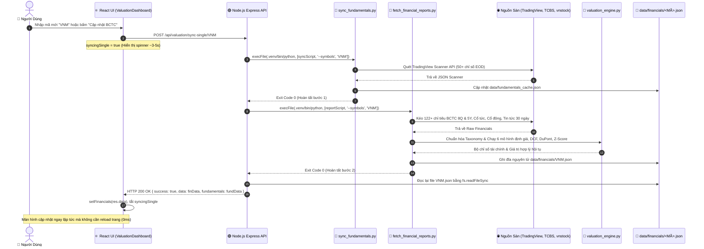
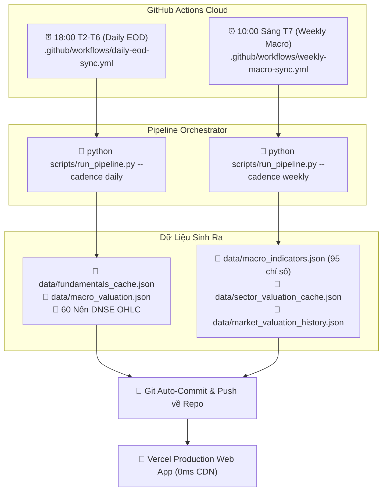

# ⚙️ BACKGROUND DATA PIPELINE & EXECUTION LIFECYCLE
### Cẩm Nang Cơ Chế Tải Dữ Liệu Nền, Điều Phối API & Chu Trình Tính Toán Hệ Thống

Tài liệu này lưu trữ đặc tả kỹ thuật chi tiết về **cơ chế tải dữ liệu nền (Background Data Pipeline)** của dự án **Stock Portfolio Manager & Enterprise Valuation Engine**. Nội dung tài liệu giải thích toàn bộ luồng xử lý bất đồng bộ từ khi Client gọi API, Node.js tiếp nhận, kích hoạt tiến trình Python ngầm, thu thập từ các nguồn cấp dữ liệu sống, tính toán mô hình định giá, lưu trữ "Local JSON First", đến khi phản hồi về giao diện.

---

## 1. Kiến Trúc 3 Tầng Vận Hành Dữ Liệu (System Architecture)

Hệ thống kết hợp mô hình Hybrid 3 tầng phân định rạch ròi trách nhiệm của từng thành phần:

```
┌────────────────────────────────────────────────────────────────────────┐
│                        TẦNG 1: REACT 18 SPA (UI)                       │
│  • Nút bấm kích hoạt bất đồng bộ (Non-blocking async/await)           │
│  • Quản lý UI State (loading, spinning, toast notification)           │
│  • Đọc dữ liệu từ API hoặc Cache với độ trễ 0ms                        │
└───────────────────────────────────┬────────────────────────────────────┘
                                    │ HTTP REST / JSON
┌───────────────────────────────────▼────────────────────────────────────┐
│                    TẦNG 2: NODE.JS EXPRESS (ORCHESTRATOR)              │
│  • Tiếp nhận request và xác thực phiên đăng nhập                       │
│  • Làm bộ điều phối (Orchestrator), KHÔNG cào web trực tiếp             │
│  • Khởi tạo tiến trình con Python cô lập qua child_process.execFile   │
│  • Đọc lại file JSON kết quả và trả về HTTP Response                   │
└───────────────────────────────────┬────────────────────────────────────┘
                                    │ IPC / Subprocess Execution (.venv)
┌───────────────────────────────────▼────────────────────────────────────┐
│                 TẦNG 3: PYTHON DATA & VALUATION ENGINE                 │
│  • Thu thập dữ liệu đa nguồn: vnstock, TCBS, DNSE, TradingView, PNJ    │
│  • Chuẩn hóa dữ liệu theo từ điển tài chính Việt Nam (financial_taxonomy)│
│  • Chạy 6 mô hình định giá, DCF 3 kịch bản, DuPont 3 nhân tố, Z-Score   │
│  • Ghi dữ liệu nguyên tử (Atomic write) vào thư mục data/              │
└────────────────────────────────────────────────────────────────────────┘
```

---

## 2. Sơ Đồ Trình Tự Thực Thi Khi Gọi API (Execution Sequence Diagram)

Dưới đây là chu trình chi tiết khi người dùng bấm nút làm mới hoặc tra cứu một mã cổ phiếu mới:



---

## 3. Giải Phẫu Chi Tiết 5 Bước Xử Lý Kỹ Thuật

### Bước 1: UI Gửi Yêu Cầu Bất Đồng Bộ (Non-Blocking Frontend Trigger)
* **File nguồn**: [`src/components/ValuationDashboard.jsx`](file:///Users/thaihai-swe/Desktop/stock/src/components/ValuationDashboard.jsx)
* **Thao tác**: Người dùng bấm nút `🔄 Cập nhật BCTC & Định Giá [MÃ]` hoặc nhập mã mới chưa có sẵn trong cache.
* **Hành vi trên UI**:
  1. Kích hoạt state loading riêng biệt: `setSyncingSingle(true)`.
  2. Nút bấm chuyển sang biểu tượng xoay `animate-spin` với nhãn `Đang nạp [MÃ] (~3-5s)...`.
  3. Giao diện người dùng vẫn hoàn toàn tương tác được (không bị đơ giao diện vì dùng `fetch()` bất đồng bộ).

### Bước 2: Node.js Khởi Tạo Subprocess Cô Lập (Subprocess Spawning)
* **File nguồn**: [`server/routes/valuationRoutes.js`](file:///Users/thaihai-swe/Desktop/stock/server/routes/valuationRoutes.js#L319-L364)
* **Endpoint**: `POST /api/valuation/sync-single/:symbol`.
* **Cơ chế**:
  * Node.js phát hiện đường dẫn binary Python ảo tại `.venv/bin/python`.
  * Dùng `child_process.execFile` để chạy Python trong môi trường con độc lập.
  * Việc này bảo vệ Event Loop của Node.js: nếu script Python chạy nặng hoặc xử lý toán học lớn, luồng chính của Node.js vẫn phục vụ các request khác bình thường (0ms block).

### Bước 3: Động Cơ Python Xử Lý Dữ Liệu Dưới Nền (Data Extraction & Analytics)
Tiến trình Python thực thi theo chuỗi 2 kịch bản:

#### 3.1. Đồng bộ chỉ số cơ bản & kỹ thuật (`scripts/sync_fundamentals.py`)
* Kết nối tới TradingView Scanner API (`vietnam.tradingview.com`).
* Trích xuất 50+ chỉ số: P/E, P/B, P/S, EV/EBITDA, ROE, ROA, Beta, RSI, Khối lượng 10D, Đáy/Đỉnh 52 tuần.
* Lưu đệm vào [`data/fundamentals_cache.json`](file:///Users/thaihai-swe/Desktop/stock/data/fundamentals_cache.json).

#### 3.2. Trích xuất BCTC & Chạy Động Cơ Định Giá (`scripts/fetch_financial_reports.py`)
1. **Thu thập dữ liệu thô (Raw Extraction)**:
   * Kết nối tới `vnstock` (`source='VCI'`) và TCBS API (`apipubaws.tcbs.com.vn`).
   * Trích xuất 3 báo cáo tài chính qua 8 quý và 5 năm:
     * *Kết quả kinh doanh (Income Statement)*: 25 chỉ tiêu (Doanh thu, Giá vốn, Lợi nhuận gộp, Chi phí bán hàng, Chi phí QLDN, Lợi nhuận thuần, LNST công ty mẹ).
     * *Cân đối kế toán (Balance Sheet)*: 35 chỉ tiêu (Tiền mặt, Phải thu, Tồn kho, Tài sản cố định, Nợ ngắn hạn, Nợ dài hạn, Vốn chủ sở hữu).
     * *Lưu chuyển tiền tệ (Cash Flow)*: 20 chỉ tiêu (Dòng tiền kinh doanh OCF, Dòng tiền đầu tư CapEx, Dòng tiền tài chính FCF).
   * Lấy lịch sử cổ tức (tiền mặt & cổ phiếu), danh sách cổ đông lớn, và tin tức sự kiện 30 ngày.
2. **Chuẩn hóa trường thông tin (Taxonomy Normalization)**:
   * Sử dụng [`scripts/lib/financial_taxonomy.py`](file:///Users/thaihai-swe/Desktop/stock/scripts/lib/financial_taxonomy.py) để đồng nhất tên trường tiếng Việt thành các key tiếng Anh chuẩn.
3. **Phân tích định lượng & định giá (Valuation Engine)**:
   * Kích hoạt [`scripts/lib/valuation_engine.py`](file:///Users/thaihai-swe/Desktop/stock/scripts/lib/valuation_engine.py):
     * *Benjamin Graham Formula*: $V = EPS \times (8.5 + 2g) \times \frac{4.4}{Y}$.
     * *Gordon Growth DDM*: $V = \frac{D_1}{r - g}$.
     * *EV / EBITDA Multiple*: Dựa trên EBITDA TTM và nợ vay ròng.
     * *P / CF Multiple*: Dựa trên dòng tiền hoạt động kinh doanh TTM.
     * *Target P/E & Target P/B*: Dựa trên P/E, P/B trung vị lịch sử ngành.
     * *Giá trị hợp lý hội tụ (Consensus Fair Value)*: Trọng số dung hòa loại bỏ ngoại lai.
     * *DCF 3 kịch bản (Base, Bull, Bear)*: Chiết khấu FCFF 5 năm kèm giá trị kết thúc (Terminal Value).
     * *Extended DuPont (3 nhân tố)*: $\text{ROE} = \text{Biên ròng} \times \text{Vòng quay tài sản} \times \text{Đòn bẩy tài chính}$.
     * *Chỉ số cảnh báo sớm*: Altman Z-score (nguy cơ phá sản) và Piotroski F-score (sức khỏe tài chính 9 tiêu chí).
4. **Ghi đĩa nguyên tử (Atomic Write)**:
   * Lưu trọn vẹn báo cáo ra file `data/financials/<MÃ>.json`.

### Bước 4: Express Đọc Kết Quả & Trả Về Client (API Response)
* Khi tiến trình Python thoát (`callback` kích hoạt):
* Node.js kiểm tra file `data/financials/<MÃ>.json` vừa được tạo hoặc cập nhật.
* Đọc nội dung file bằng `fs.readFileSync` và trả về HTTP 200 kèm JSON payload.

### Bước 5: UI Cập Nhật Tức Thì (State Sync & Cache Hit)
* React nhận dữ liệu JSON:
  * Tắt trạng thái xoay: `setSyncingSingle(false)`.
  * Cập nhật React state: Thẻ Hero định giá, biên an toàn MoS %, ma trận độ nhạy DCF, biểu đồ 8 quý tự động hiển thị dữ liệu mới.
* **Lần truy cập tiếp theo**: Bất kỳ khi nào người dùng quay lại mã này, hệ thống đọc trực tiếp từ file JSON cục bộ với độ trễ **0ms** mà không cần gọi lại Python.

---

## 4. Cơ Chế Chạy Nền Tự Động Theo Lịch Hẹn (Scheduled Background Sync)

Ngoài việc kích hoạt qua giao diện, hệ thống được trang bị bộ điều phối lịch hẹn tự động chạy độc lập mà không cần người dùng mở máy:



| Chu Kỳ | Thời Điểm Chạy | Bộ Điều Phối Kích Hoạt | Dữ Liệu Thu Thập | File Cập Nhật |
| :--- | :--- | :--- | :--- | :--- |
| **Daily EOD** | 18:00 T2 - T6 | `python scripts/run_pipeline.py --cadence daily` | 50+ chỉ số TradingView Scanner, Giá đóng cửa EOD, 60 nến DNSE, Giá vàng SJC/PNJ, Dầu Brent, Tỷ giá USD/VND. | `fundamentals_cache.json`, `macro_valuation.json` |
| **Weekly Macro** | 10:00 Sáng Thứ 7 | `python scripts/run_pipeline.py --cadence weekly` | 95 Chỉ số TradingEconomics (10 nhóm vĩ mô), Luân chuyển 10 ngành GICS Vietstock, Lịch sử P/E 10 năm Google Sheets. | `macro_indicators.json`, `sector_valuation_cache.json`, `market_valuation_history.json` |
| **Quarterly BCTC** | Mùa BCTC (Tháng 1, 4, 7, 10) | `python scripts/run_pipeline.py --cadence quarterly` | 122+ Chỉ tiêu BCTC 8 quý & 5 năm, 54 Ratios, Extended DuPont, DCF 3 kịch bản, Cổ đông. | `data/financials/<MÃ>.json` |

---

## 5. Bảng Tổng Hợp Endpoint API, Script Thực Thi & Tác Vụ Dưới Nền

| HTTP Method & Endpoint | Script Backend Kích Hoạt | Nguồn Dữ Liệu Gốc | Thời Gian Chạy | Tác Vụ Thực Hiện Dưới Nền |
| :--- | :--- | :--- | :--- | :--- |
| `POST /api/valuation/sync-single/:symbol` | `sync_fundamentals.py`<br>`fetch_financial_reports.py` | TradingView, TCBS, vnstock | **3 - 5 giây** | Cào và định giá chuyên sâu cho riêng 1 mã cổ phiếu, ghi file `data/financials/<MÃ>.json`. |
| `POST /api/valuation/sync` | `scripts/run_full_pipeline.py` | Đa nguồn (Toàn thị trường) | **15 - 35 giây** | Chạy toàn bộ pipeline: TradingView, Vĩ mô VN-Index, Lợi suất HNX, và toàn bộ BCTC. |
| `POST /api/fundamentals/sync` | `scripts/sync_fundamentals.py` | TradingView Scanner | **4 - 8 giây** | Quét 50+ chỉ số cơ bản & định giá EOD cho toàn bộ danh sách mã theo dõi. |
| `GET /api/prices?force=true` | Node.js `priceService.js` (không qua Python) | VPS Live API | **~300ms** | Lấy thị giá khớp lệnh thời gian thực của các mã cổ phiếu từ sàn HOSE/HNX (bỏ qua cache 1h). |
| `GET /api/valuation/dnse-ohlc` | Node.js proxy (kèm fallback direct) | DNSE Open API | **~300ms** | Lấy chuỗi nến thời gian thực của VN-Index/VN30 phục vụ vẽ biểu đồ kỹ thuật. |
| `GET /api/data` | Node.js `orderRoutes.js` | SQLite `stock.db` | **~50ms** | Đọc lại toàn bộ sổ cái cá nhân (lệnh mua, lệnh bán, cổ tức, tiền mặt) từ Database SQLite. |

---

## 6. Cơ Chế Chịu Lỗi & An Toàn Dữ Liệu (Resilience & Safety)

1. **Cô lập tiến trình (Subprocess Isolation)**:
   Nếu một script Python bị lỗi kết nối hoặc thư viện ngoài ném ngoại lệ (Exception), tiến trình con sẽ thoát an toàn mà không làm gián đoạn hoặc sập Web Server Node.js.
2. **Ghi đệm nguyên tử (Atomic File Writing)**:
   Mọi file JSON đều được ghi trực tiếp dưới dạng chuỗi UTF-8 hoàn chỉnh. Nếu quá trình tải bị hủy ngang, file cũ vẫn được giữ nguyên vẹn, tránh tình trạng file JSON rỗng hoặc hỏng cấu trúc.
3. **Cơ chế dự phòng đa tầng (Graceful Fallback)**:
   * Nếu VPS API lỗi $\rightarrow$ Hệ thống tự động chuyển sang đọc giá từ bộ đệm `data/prices_cache.json`.
   * Nếu Python gặp sự cố $\rightarrow$ Endpoint `/fundamentals/sync` tự động kích hoạt **JavaScript Fallback Service** để tải dữ liệu cơ bản qua Node.js fetch.
4. **Local JSON First (Phục vụ 0ms)**:
   Toàn bộ màn hình phân tích vĩ mô và định giá luôn ưu tiên đọc trực tiếp từ các file JSON tĩnh trong thư mục `data/`. Nhờ đó, ứng dụng hoạt động với độ trễ 0ms và hoàn toàn có thể chạy mượt mà ngay cả khi mất kết nối Internet.
