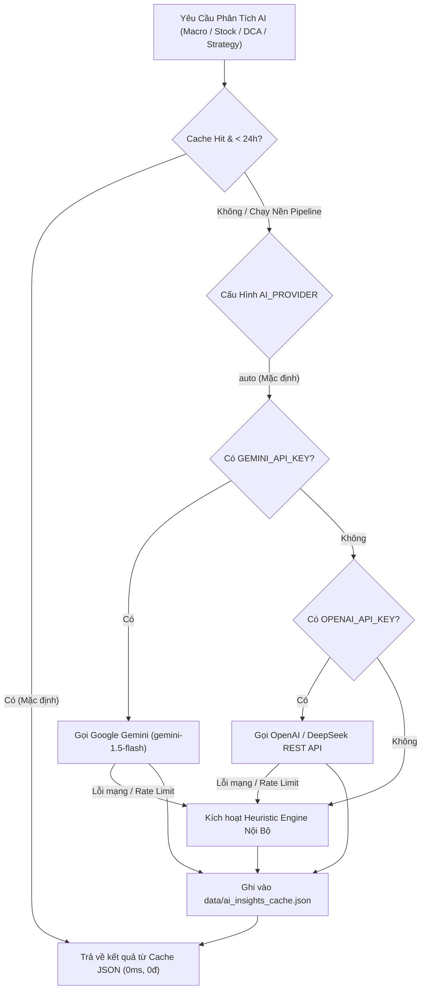

# 🌐 CẨM NANG CẤU HÌNH BIẾN MÔI TRƯỜNG & TRIỂN KHAI HỆ THỐNG
### (GitHub Actions · Vercel Production · Turso Cloud · AI Multi-Provider · Local Dev)

Tài liệu này là quy chuẩn kỹ thuật chính thức hướng dẫn cách phân bổ, thiết lập và quản trị các biến môi trường (**Environment Variables & Secrets**) giữa **GitHub Actions**, **Vercel** và **Máy cục bộ (Local)**. Việc tuân thủ quy chuẩn này đảm bảo hệ thống vận hành bảo mật, ổn định, duy trì tốc độ phản hồi **0ms** và triệt tiêu 100% chi phí gọi API AI không cần thiết.

---

## 📑 MỤC LỤC
1. [Triết Lý Kiến Trúc & Nguyên Tắc Phân Tách Môi Trường](#1-triết-lý-kiến-trúc--nguyên-tắc-phân-tách-môi-trường)
2. [Ma Trận Phân Bổ Biến Môi Trường (The Environment Matrix)](#2-ma-trận-phân-bổ-biến-môi-trường-the-environment-matrix)
3. [Hướng Dẫn Thiết Lập Chi Tiết Từng Nền Tảng](#3-hướng-dẫn-thiết-lập-chi-tiết-từng-nền-tảng)
   - [A. Cấu hình tại GitHub Actions (Data Pipeline & Background AI)](#a-cấu-hình-tại-github-actions-data-pipeline--background-ai)
   - [B. Cấu hình tại Vercel (Production Web Hosting & Serverless API)](#b-cấu-hình-tại-vercel-production-web-hosting--serverless-api)
   - [C. Cấu hình tại Local Development (.env)](#c-cấu-hình-tại-local-development-env)
4. [Hệ Sinh Thái AI Copilot: Chiến Lược Provider & Token](#4-hệ-sinh-thái-ai-copilot-chiến-lược-provider--token)
5. [Cơ Chế Đồng Bộ Database: Turso Cloud vs Local SQLite](#5-cơ-chế-đồng-bộ-database-turso-cloud-vs-local-sqlite)
6. [Quy Trình Kiểm Thử & Xử Lý Sự Cố (Troubleshooting)](#6-quy-trình-kiểm-thử--xử-lý-sự-cố-troubleshooting)

---

## 1. Triết Lý Kiến Trúc & Nguyên Tắc Phân Tách Môi Trường

Hệ thống được thiết kế theo nguyên tắc **"Tách Rời Tính Toán Nặng & Trình Diễn Tốc Độ Cao"** (Decoupled Compute & Presentation):

```
┌─────────────────────────────────────────────────────────────────────────────┐
│ 1. GITHUB ACTIONS (Máy Chủ Chạy Nền Định Kỳ - Scheduler & Data Engine)       │
│  • Mục đích: Cào dữ liệu EOD, tính toán định giá Python, sinh báo cáo AI    │
│  • Tần suất: 18:00 T2-T6 (Daily), 10:00 T7 (Weekly), Hàng quý (BCTC)       │
│  • AI Keys: BẮT BUỘC ĐẶT TẠI ĐÂY (Nơi thực sự gọi LLM sinh dữ liệu)          │
│  • Output: Commit các file JSON snapshot (ai_insights_cache.json, etc.)      │
└──────────────────────────────────────┬──────────────────────────────────────┘
                                       │ Git Commit & Push Snapshot tự động
┌──────────────────────────────────────▼──────────────────────────────────────┐
│ 2. VERCEL (Nền Tảng Hosting Frontend SPA & Serverless API)                   │
│  • Mục đích: Phục vụ hàng triệu lượt xem của người dùng 24/7                │
│  • Cơ chế: Đọc trực tiếp các file JSON snapshot có sẵn (Độ trễ 0ms)        │
│  • AI Keys: KHÔNG BẮT BUỘC (Khuyến nghị KHÔNG ĐẶT để tránh bị spam gọi API)  │
│  • Database: BẮT BUỘC CẦN Turso Cloud SQLite (để lưu sổ lệnh mua/bán ACID)  │
└─────────────────────────────────────────────────────────────────────────────┘
```

### Tại Sao AI Keys Phải Nằm Ở GitHub Actions Thay Vì Vercel?
1. **Triệt tiêu chi phí & Chống spam token**: Nếu bạn đặt AI API Key trên Vercel, bất kỳ ai truy cập website cũng có thể bấm nút "Phân tích lại AI" liên tục, làm cạn sạch hạn ngạch (Rate Limit 429) và phát sinh hóa đơn tiền triệu. Khi đưa việc gọi AI vào GitHub Actions theo lịch trình EOD/Weekly, mỗi ngày hệ thống chỉ gọi LLM đúng 1 lần khi thị trường đóng cửa.
2. **Độ trễ hiển thị 0ms (Cache-First)**: Người dùng mở tab Vĩ Mô hay Định Giá không phải chờ đợi 5–15 giây để LLM sinh câu chữ. Toàn bộ nhận định đã được chuẩn bị sẵn trong [`data/ai_insights_cache.json`](file:///Users/thaihai-swe/Desktop/stock/data/ai_insights_cache.json) và [`data/financials/<MÃ>.json`](file:///Users/thaihai-swe/Desktop/stock/data/financials/) để React tải ngay tức thì.
3. **Hai lớp bảo vệ tự chủ (Two-Tier Fallback)**: Kể cả khi không có API Key hoặc mạng bị ngắt, bộ động cơ **Heuristic Deterministic Engine** tích hợp sẵn vẫn tự động phân tích định lượng chuyên sâu 100% offline.

---

## 2. Ma Trận Phân Bổ Biến Môi Trường (The Environment Matrix)

| Biến Môi Trường | GitHub Actions | Vercel Prod | Local `.env` | Định Dạng / Giá Trị Mẫu | Mô Tả Chức Năng |
| :--- | :---: | :---: | :---: | :--- | :--- |
| **`GEMINI_API_KEY`** | **BẮT BUỘC** ⭐ | *Không nên đặt* | Tùy chọn | `AIzaSy...` | Khóa API Google Gemini để sinh báo cáo AI tự động. |
| **`GEMINI_MODEL`** | *Nên đặt* (Secrets/Vars)| *Không cần* | Có | `gemini-1.5-flash` \| `gemini-1.5-pro` \| `gemini-2.0-flash` | Mô hình Google Gemini mong muốn (`gemini-1.5-flash` là mặc định). |
| **`OPENAI_API_KEY`** | *Tùy chọn* | *Không nên đặt* | Tùy chọn | `sk-...` | Khóa API OpenAI / DeepSeek / Groq (nếu không dùng Gemini). |
| **`OPENAI_BASE_URL`** | *Tùy chọn* | *Không nên đặt* | Tùy chọn | `https://api.deepseek.com/v1` | URL endpoint tùy chỉnh tương thích chuẩn OpenAI. |
| **`OPENAI_MODEL`** | *Tùy chọn* | *Không cần* | Có | `gpt-4o-mini` \| `deepseek-chat` | Tên mô hình khi sử dụng OpenAI Standard API. |
| **`AI_PROVIDER`** | *Nên đặt* | *Không cần* | Có | `auto` \| `gemini` \| `openai` | Nhà cung cấp AI ưu tiên (`auto` tự phát hiện key). |
| **`AI_MODEL`** | *Tùy chọn* | *Không cần* | Có | `gemini-1.5-flash` \| `deepseek-chat` | Tên mô hình LLM chung (dự phòng cho cả hai provider). |
| **`TURSO_DATABASE_URL`**| **BẮT BUỘC** ⭐ | **BẮT BUỘC** ⭐ | Có (khi dev cloud)| `libsql://your-db.turso.io` | URL kết nối Turso Cloud SQLite. |
| **`TURSO_AUTH_TOKEN`** | **BẮT BUỘC** ⭐ | **BẮT BUỘC** ⭐ | Có (khi dev cloud)| `eyJhbGciOi...` | Token bảo mật truy cập Turso DB. |
| **`DB_MODE`** | *Không cần* | **BẮT BUỘC** (`turso`)| Có (`local`)\|(`turso`)| `local` (dùng file `stock.db`) hoặc `turso` (dùng cloud). |
| **`GOOGLE_CLIENT_ID`** | *Không cần* | **BẮT BUỘC** *(nếu bật Auth)* | Tùy chọn | `xxxx.apps.googleusercontent.com` | Client ID cho Backend Node.js verify Google Token. |
| **`VITE_GOOGLE_CLIENT_ID`**| *Không cần* | **BẮT BUỘC** *(nếu bật Auth)* | Tùy chọn | `xxxx.apps.googleusercontent.com` | Client ID cho Frontend React hiển thị nút Login. |
| **`PORT`** | *Không cần* | *Không cần* (Vercel tự gán) | Có | `3001` | Cổng lắng nghe của Express Server ở môi trường local. |

---

## 3. Hướng Dẫn Thiết Lập Chi Tiết Từng Nền Tảng

### A. Cấu Hình Tại GitHub Actions (Data Pipeline & Background AI)

GitHub Actions chịu trách nhiệm chạy các workflow:
* [`.github/workflows/daily-eod-sync.yml`](file:///Users/thaihai-swe/Desktop/stock/.github/workflows/daily-eod-sync.yml) (18:00 T2-T6)
* [`.github/workflows/weekly-macro-sync.yml`](file:///Users/thaihai-swe/Desktop/stock/.github/workflows/weekly-macro-sync.yml) (10:00 Sáng T7)
* [`.github/workflows/quarterly-bctc-sync.yml`](file:///Users/thaihai-swe/Desktop/stock/.github/workflows/quarterly-bctc-sync.yml) (Mùa BCTC)

#### Các bước thực hiện:
1. Mở trang Repository dự án trên GitHub.
2. Điều hướng vào: **Settings** &rarr; (Menu bên trái) **Secrets and variables** &rarr; **Actions**.
3. Tại mục **Repository secrets**, nhấn nút **New repository secret** để thêm các biến nhạy cảm:

```ini
# 1. API Key cho AI Copilot (Khuyến nghị Gemini):
GEMINI_API_KEY = AIzaSyxxxxxxxxxxxxxxxxxxxxxx

# 2. Thông tin kết nối Turso Database (Để quét hàng đợi mã requested_stocks):
TURSO_DATABASE_URL = libsql://stock-xxxx.turso.io
TURSO_AUTH_TOKEN = eyJhbGciOiJKV1QiLCJhbGciOi...
```

4. *(Tùy chọn)* Tại mục **Variables** (cạnh tab Secrets), bạn có thể đặt các biến cấu hình công khai mà không cần tạo secret:

```ini
# Tùy biến model Gemini (Hệ thống hỗ trợ cả Secrets và Variables):
GEMINI_MODEL = gemini-1.5-flash
# (hoặc gemini-1.5-pro, gemini-2.0-flash, gemini-2.0-flash-lite)
```

> [!NOTE]
> Tại sao GitHub Actions cần biến Turso? Khi người dùng tra cứu một mã cổ phiếu mới chưa có trong hệ thống trên web Vercel, web sẽ ghi mã đó vào bảng `requested_stocks` trên Turso. Khi GitHub Actions chạy EOD, nó đọc bảng này từ Turso để cào BCTC và sinh định giá tự động cho mã đó.

---

### B. Cấu Hình Tại Vercel (Production Web Hosting & Serverless API)

Vercel phục vụ ứng dụng React SPA và các Serverless Functions tại [`api/index.js`](file:///Users/thaihai-swe/Desktop/stock/api/index.js).

#### Các bước thực hiện:
1. Đăng nhập [Vercel Dashboard](https://vercel.com) &rarr; Chọn dự án của bạn.
2. Chọn tab **Settings** &rarr; Chọn mục **Environment Variables** ở thanh bên trái.
3. Thêm các biến sau (tích chọn áp dụng cho cả 3 môi trường: **Production**, **Preview**, **Development**):

| Key | Value Mẫu | Giải Thích |
| :--- | :--- | :--- |
| **`DB_MODE`** | `turso` | **Bắt buộc**: Vercel là môi trường Stateless, không thể lưu dữ liệu vào file `data/stock.db` cục bộ. |
| **`TURSO_DATABASE_URL`** | `libsql://stock-xxxx.turso.io` | URL Turso Cloud Database của bạn. |
| **`TURSO_AUTH_TOKEN`** | `eyJhbGci...` | Token xác thực Turso. |
| **`GOOGLE_CLIENT_ID`** | `xxx.apps.googleusercontent.com` | *(Tùy chọn)* Dành cho Backend xác thực Google Login. |
| **`VITE_GOOGLE_CLIENT_ID`** | `xxx.apps.googleusercontent.com` | *(Tùy chọn)* Dành cho Frontend hiển thị nút Google Login. |

> [!TIP]
> **Khuyến nghị về AI trên Vercel (100% Decoupled)**:
> **TUYỆT ĐỐI KHÔNG CẦN** cấu hình `GEMINI_API_KEY`, `GEMINI_MODEL` hay bất kỳ biến AI nào trên Vercel.
> * Toàn bộ mã gọi LLM phía JavaScript đã được gỡ bỏ hoàn toàn để tuân thủ kiến trúc Single Source of Truth.
> * Vercel và Frontend React chỉ đóng vai trò đọc dữ liệu 0ms có sẵn từ các snapshot tĩnh ([`data/macro_valuation.json`](file:///Users/thaihai-swe/Desktop/stock/data/macro_valuation.json) và [`data/financials/<MÃ>.json`](file:///Users/thaihai-swe/Desktop/stock/data/financials/)) do Python Background Pipeline sinh sẵn.
> * Điều này giúp loại bỏ 100% rủi ro bị spam API key, không phát sinh chi phí, và bảo mật tuyệt đối.

---

### C. Cấu Hình Tại Local Development (`.env`)

Môi trường máy tính cá nhân phục vụ việc lập trình, chạy thử nghiệm và kiểm thử tính năng:

1. Sao chép file mẫu:
   ```bash
   cp .env.example .env
   ```
2. Nội dung file `.env` chuẩn khuyến nghị:
   ```ini
   # 1. Chạy hoàn toàn Offline với SQLite cục bộ:
   DB_MODE=local
   PORT=3001

   # 2. (Tùy chọn) Điền key AI nếu muốn chạy thử CLI scripts/generate_ai_insights.py:
   AI_PROVIDER=auto
   GEMINI_API_KEY=your_gemini_api_key_here

   # Hoặc dùng DeepSeek:
   # OPENAI_API_KEY=your_deepseek_key_here
   # OPENAI_BASE_URL=https://api.deepseek.com/v1
   # OPENAI_MODEL=deepseek-chat
   ```

---

## 4. Hệ Sinh Thái AI Copilot: Chiến Lược Provider & Token

Hệ thống hỗ trợ kiến trúc **Đa Nhà Cung Cấp (Multi-Provider)** và tự động chuyển đổi thông minh:



### So Sánh 3 Lựa Chọn AI Hàng Đầu:
1. **Google Gemini (Khuyến Nghị Hàng Đầu - Miễn Phí)**:
   * **Biến cấu hình**: `GEMINI_API_KEY` và `GEMINI_MODEL` (Mặc định: `gemini-1.5-flash`).
   * **Các mô hình hỗ trợ**:
     - `gemini-1.5-flash`: Tốc độ cao, tiết kiệm token, ngữ cảnh 1M token (Khuyến nghị chuẩn).
     - `gemini-1.5-pro`: Suy luận phức tạp, phân tích báo cáo tài chính 10 mô hình và vĩ mô chuyên sâu (2M token).
     - `gemini-2.0-flash`: Thế hệ mới nhất tốc độ cực nhanh, phản hồi thời gian thực với độ trễ thấp vượt trội.
     - `gemini-2.0-flash-lite`: Bản siêu nhẹ tối ưu quota miễn phí.
   * **Chi phí**: **0 đồng** (Google AI Studio cấp hạn ngạch miễn phí 15 requests/phút, thoải mái cho cronjob hằng ngày).
   * **Cách lấy key**: Truy cập [aistudio.google.com/app/apikey](https://aistudio.google.com/app/apikey) &rarr; Tạo API Key.
2. **DeepSeek API (Chất Lượng Cao, Chi Phí Cực Thấp)**:
   * **Mô hình**: `deepseek-chat` (suy luận tài chính và tiếng Việt xuất sắc).
   * **Cấu hình**: `OPENAI_BASE_URL=https://api.deepseek.com/v1`, `OPENAI_MODEL=deepseek-chat`.
   * **Chi phí**: Cực rẻ (~0.002$ cho 1 lượt phân tích toàn diện).
3. **Bộ Động Cơ Dự Phòng Deterministic Heuristic (Offline Fallback Engine)**:
   * **Nguyên lý**: 100% mã nguồn mở cục bộ viết bằng JavaScript & Python.
   * **Chức năng**: Đọc trực tiếp các số liệu P/E Bands, DuPont, Beneish M-Score, MoS %, Sharpe Ratio và luận giải theo luật chuyên gia tài chính.
   * **Ưu điểm**: Không cần internet, không cần API Key, không bao giờ lỗi.

---

## 5. Cơ Chế Đồng Bộ Database: Turso Cloud vs Local SQLite

Hệ thống quản lý dữ liệu giao dịch người dùng (Sổ lệnh Mua, Bán, Cổ tức, Watchlist) theo 2 chế độ độc lập:

### 1. Chế độ `DB_MODE=local`:
* **Vị trí lưu trữ**: Tệp [`data/stock.db`](file:///Users/thaihai-swe/Desktop/stock/data/stock.db).
* **Mục đích**: Chạy phát triển offline trên máy cá nhân, bảo mật tuyệt đối 100%, không cần kết nối mạng.
* **Trạng thái Git**: Đã được đưa vào `.gitignore` (không bao giờ commit thông tin cá nhân lên GitHub).

### 2. Chế độ `DB_MODE=turso`:
* **Vị trí lưu trữ**: Turso SQLite Cloud.
* **Mục đích**: Phục vụ ứng dụng Production chạy trên Vercel hoặc đồng bộ dữ liệu giao dịch giữa máy tính và điện thoại.
* **Tạo database miễn phí**:
  1. Cài đặt Turso CLI: `brew install tursodatabase/tap/turso` hoặc qua `curl -sSfL https://get.turso.tech/install.sh | bash`.
  2. Đăng ký & đăng nhập: `turso auth signup` hoặc `turso auth login`.
  3. Tạo DB: `turso db create stock-db`.
  4. Lấy URL: `turso db show stock-db --url`.
  5. Lấy Token: `turso db tokens create stock-db`.

### 3. Đồng Bộ & Sao Lưu Qua CLI (`scripts/db_manager.py`):
```bash
# Kiểm tra trạng thái DB:
.venv/bin/python scripts/db_manager.py status

# Xuất dữ liệu từ SQLite ra file backup JSON:
.venv/bin/python scripts/db_manager.py export --output data/backups/manual_backup.json

# Đẩy dữ liệu từ file backup JSON lên Turso Cloud:
.venv/bin/python scripts/db_manager.py import --input data/backups/manual_backup.json --mode turso
```

---

## 6. Quy Trình Kiểm Thử & Xử Lý Sự Cố (Troubleshooting)

### A. Kiểm Tra Chạy Thử GitHub Actions AI Pipeline:
1. Vào GitHub Repository &rarr; Tab **Actions**.
2. Chọn workflow **Daily EOD Stock Fundamentals & Macro Sync (Python)**.
3. Nhấn **Run workflow** &rarr; Chọn branch `main` &rarr; Nhấn **Run workflow**.
4. Mở xem logs của workflow:
   * Bước `Chạy Daily EOD Pipeline` sẽ in ra dòng: `[AI] Sinh thành công bản tin EOD...`.
   * Bước `Tự động Commit & Push` sẽ commit tệp `data/ai_insights_cache.json` lên repo với tin nhắn: `chore(data): daily EOD market & fundamentals sync [skip ci]`.

### B. Kiểm Tra Vercel Deployment:
1. Khi GitHub có commit mới từ GitHub Actions, Vercel sẽ tự động kích hoạt build lại trong 30 giây.
2. Mở Vercel logs tại tab **Deployments** &rarr; Chọn deployment mới nhất.
3. Đảm bảo build kết thúc với thông báo thành công: `✓ built in ~3.7s`.
4. Mở trang web Production:
   * Mở tab **Vĩ mô & VN-Index**: Bản tin vĩ mô AI phải hiển thị đầy đủ tiêu đề, phân tích liên thị trường và khuyến nghị tài sản.
   * Mở tab **Dashboard**: Các thẻ KPI, Alpha ngân hàng và danh mục tải ngay lập tức trong **0ms**.

### C. Các Mã Lỗi Thường Gặp & Cách Khắc Phục:

| Mã Lỗi / Hiện Tượng | Nguyên Nhân | Cách Khắc Phục |
| :--- | :--- | :--- |
| **`Chưa cấu hình TURSO_DATABASE_URL trên Vercel!`** | Thiếu biến môi trường trên Vercel. | Vào Vercel Settings &rarr; Environment Variables &rarr; Thêm `TURSO_DATABASE_URL`, `TURSO_AUTH_TOKEN`, `DB_MODE=turso`. Sau đó Redeploy. |
| **`Google Token Verification Failed`** | Sai `GOOGLE_CLIENT_ID` giữa Frontend và Backend. | Đảm bảo cả `GOOGLE_CLIENT_ID` và `VITE_GOOGLE_CLIENT_ID` đều có chung giá trị Client ID từ Google Cloud Console. |
| **`Gemini API Error 429: Resource Exhausted`** | Hết hạn ngạch tạm thời của Google AI. | Hệ thống tự động chuyển sang Heuristic Engine. Để reset quota, đợi vài phút hoặc đổi sang API key khác. |
| **`GitHub Action: Permission to repository denied`** | Workflow không có quyền push commit. | Vào GitHub Repo &rarr; **Settings** &rarr; **Actions** &rarr; **General** &rarr; Mục **Workflow permissions** &rarr; Tích chọn **Read and write permissions** &rarr; Nhấn **Save**. |
